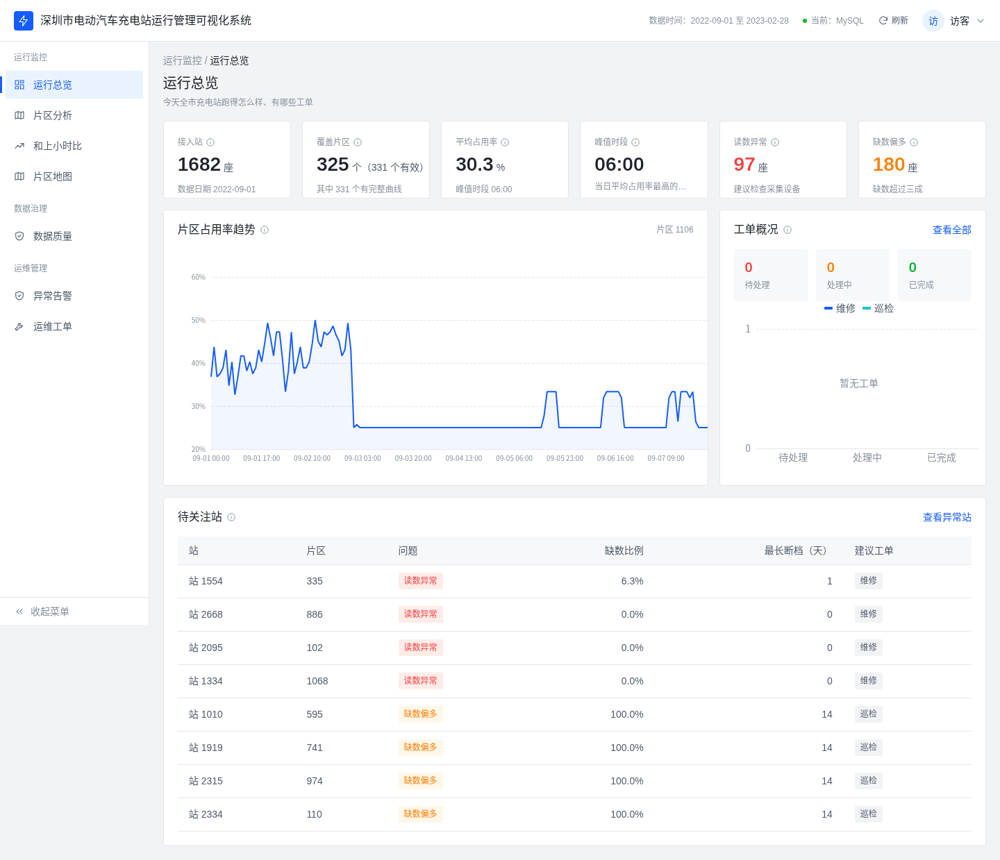
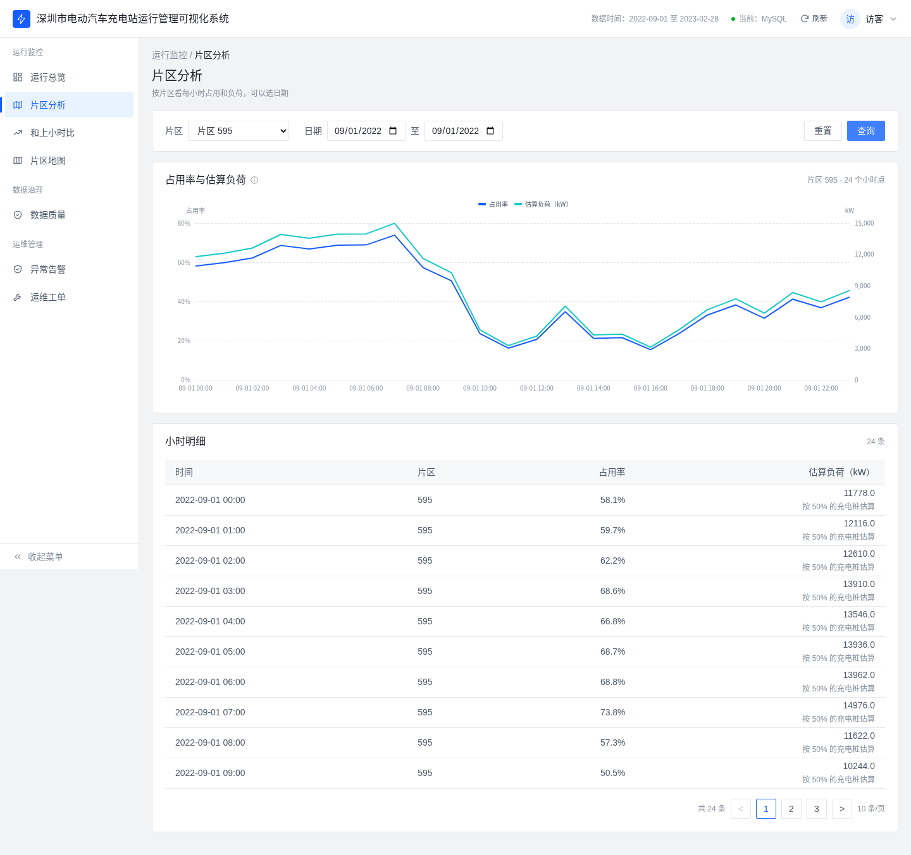
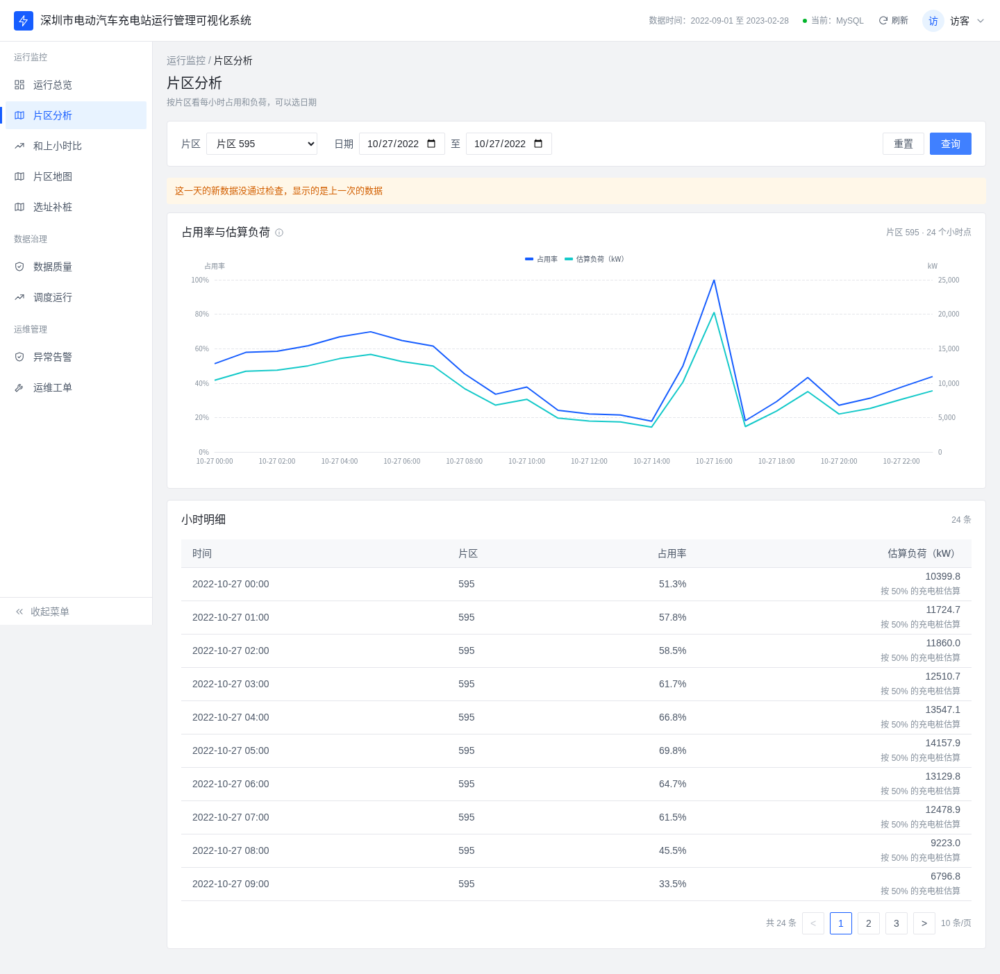
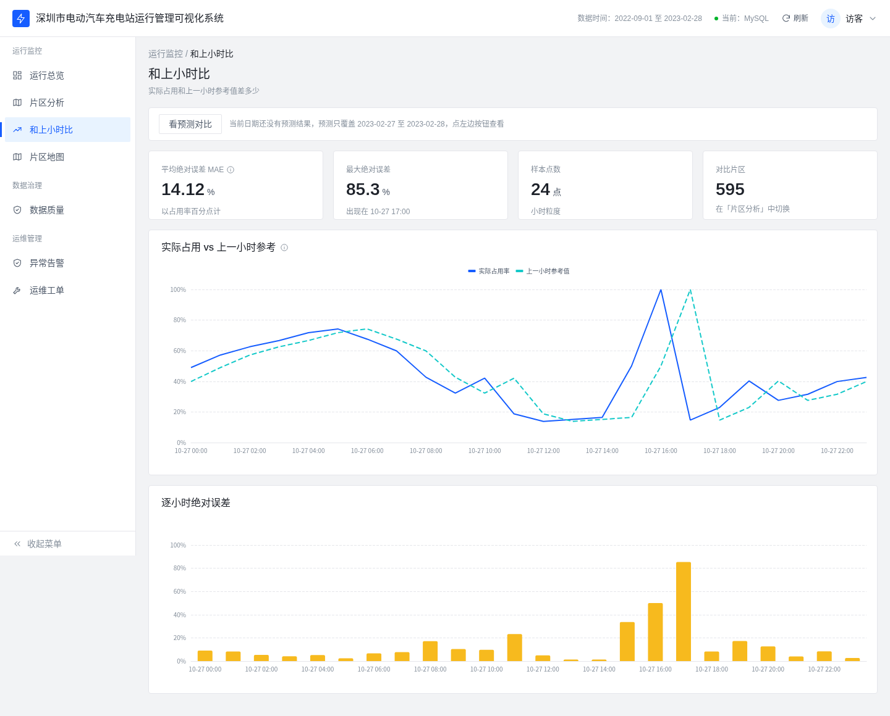
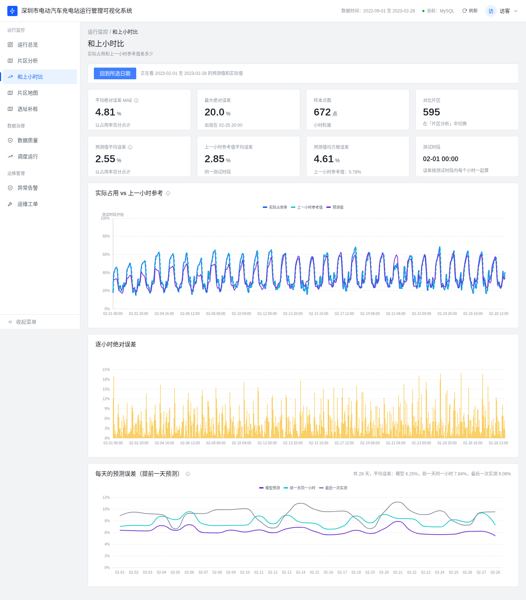
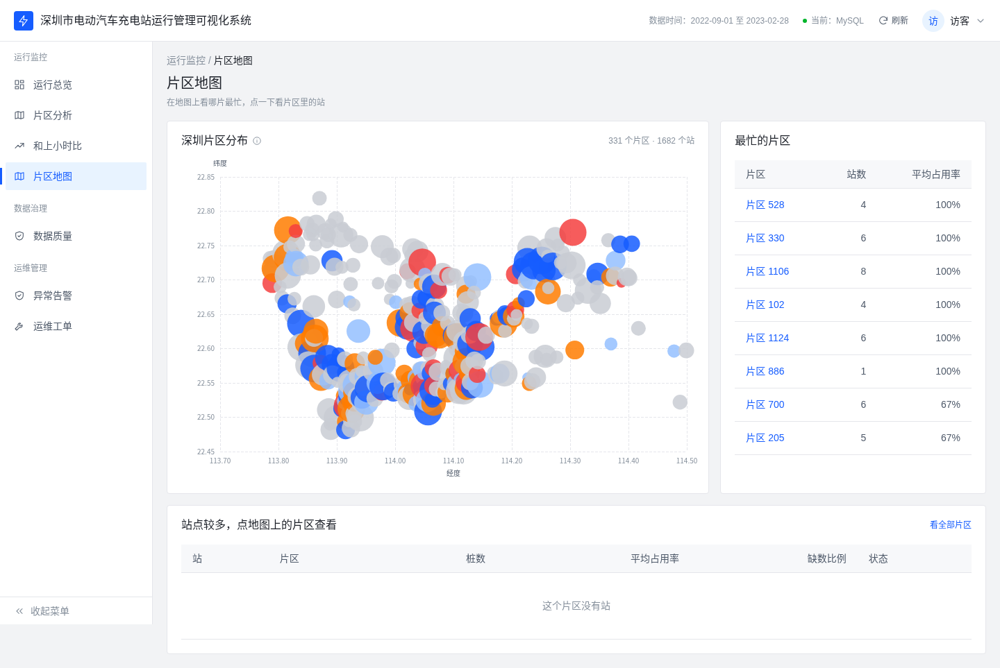
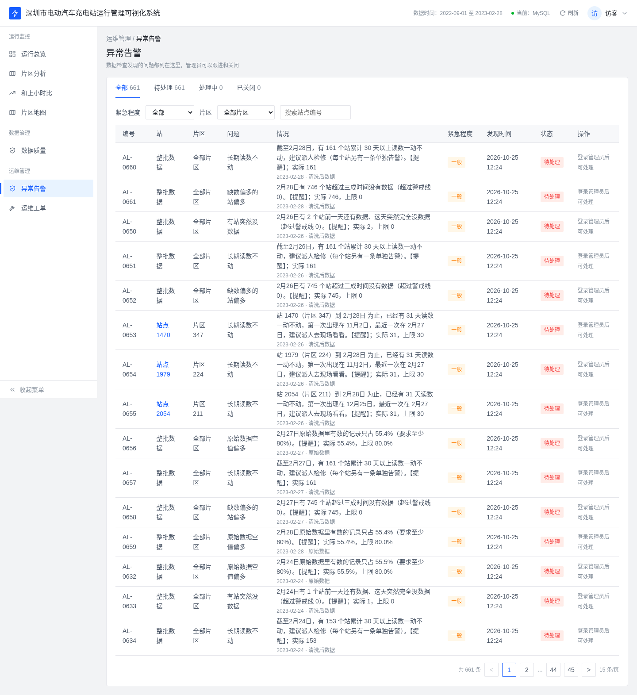
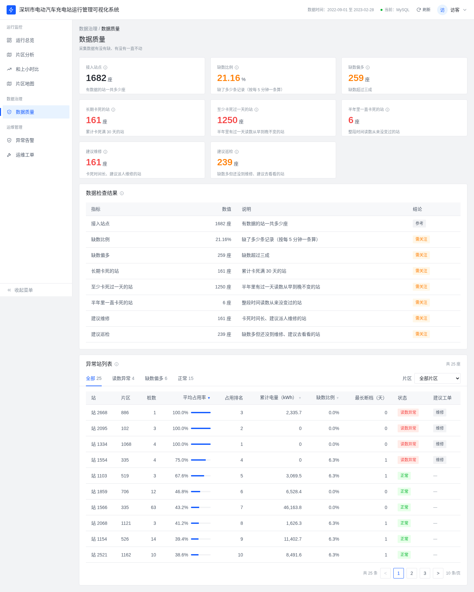
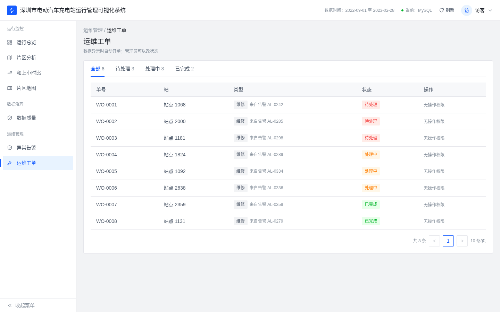

# 深圳市电动汽车充电站运行管理可视化系统

本项目为个人数据工程项目，基于公开数据集 [UrbanEV](https://doi.org/10.1038/s41597-025-04874-4)（深圳电动汽车充电站 5 分钟粒度运行数据，CC0）对 1,682 个站、181 天（2022-09-01 至 2023-02-28）的全量数据，构建「数据湖 → Spark/Hive 指标 → MySQL → API → 页面」的完整链路，带每日调度、数据质检告警和运维工单。

仓库地址：https://github.com/inkrhymes/sz-ev-charging

---

## 1. 架构

```
UrbanEV 原始 5 分钟 CSV（1,682 站 / 181 天）
  → Parquet 数据湖：ods（原样落地）/ dwd（清洗、卡死与缺失判定，含 quality_station、pile_power）
  → PySpark + Hive：ads 指标（片区小时占用率、负荷估算、朴素基线、城市总览）
  → MySQL 8（sz_ev 库，ads_* / dim_station / dq_alert / ads_ticket）
  → Flask API（localhost:5000）
  → ECharts 页面（总览、片区、基线与预测、地图、告警、数据质量、工单）
```

- **调度：** Airflow DAG `sz_ev_daily`，每天 7 个任务，在 ods / dwd / ads 三层之间各设一道质检门。
- **质检被拦的日子：** 当天新数据不会覆盖进库，**保留上一次发布的数据**，并由 `dq_alert` 里的告警标出来；页面在这些日子会提示「显示的是上一次的数据」。例：2022-10-27 有 838 个站前一天有数、当天全空，超过阈值 50，在 dwd 质检被拦。
- **预测：** LightGBM 预测片区下一小时占用率，和「直接用上一小时」对比（见 `forecast/README.md`）。
- **工单：** 管理员从告警派工单，工单关联 `alert_id`，状态 open → processing → done。

## 2. 关键数字

| 项目 | 数值 | 出处 |
|------|------|------|
| 全量小时表 | 1,338,568 行（MySQL 与 Hive 一致） | `docs/perf/spark_baseline.md` |
| 全量 ETL（数据湖） | 2 分 03 秒（拆分并行前 7 分 25 秒） | ETL 提交记录 |
| Spark 全量 181 天 ads | 119 秒 | `docs/perf/spark_baseline.md` |
| Airflow 单日 | 7 个任务约 2 分钟 | `docs/orchestration_design.md` |
| 质检告警 | 661 条 | `docs/orchestration_design.md` |
| LightGBM vs 上一小时 | MAE 0.0255 vs 0.0285；RMSE 0.0461 vs 0.0578 | `forecast/README.md` |
| 覆盖索引 | 查询约 220 ms → 约 2 ms | `docs/perf/spark_baseline.md` |
| 测试 | CI 文件模式 138 个通过、6 个跳过（Python 3.11 / 3.12），页面检查 13 个通过 | GitHub Actions |

## 3. 运行

```bash
cp .env.example .env
MYSQL_DATA_DIR=$PWD/data/mysql bash scripts/start.sh   # MySQL 数据放在可持久的目录，重启不丢
python3 scripts/smoke_live.py                          # 线上冒烟检查（8 项）
```

- `MYSQL_DATA_DIR`：MySQL 数据目录，建议指向持久目录。
- `SKIP_DEMO_SEED=1`：跳过演示数据装载（库里已有全量数据时会自动跳过）。
- `API_SOURCE=file`：API 改读本机文件，不连 MySQL（默认 `mysql`）。
- `API_STRICT_MYSQL=1`：MySQL 不可用时直接返回 503，不退回文件。
- 重启后容器之间连不通时：`sudo sysctl -w net.bridge.bridge-nf-call-iptables=0`（`scripts/start.sh` 会尽量自动设置）。
- Airflow：`docker compose -f orchestration/docker-compose.airflow.yml up -d`，详见 `docs/orchestration_design.md`。
- 停止：`./scripts/stop.sh`（保留数据）/ `./scripts/stop.sh --purge`。

## 4. 截图

| 页面 | 截图 |
|------|------|
| 总览 |  |
| 片区 |  |
| 片区（质检被拦的日子） |  |
| 基线 |  |
| 基线与预测 |  |
| 地图 |  |
| 告警 |  |
| 已关闭告警 |  |
| 数据质量 |  |
| 工单 |  |
| 工单（管理员，1280 宽） |  |

## 5. 相关文档

| 文档 | 内容 |
|------|------|
| `docs/architecture.md` | 整体架构、测试与预测 |
| `docs/orchestration_design.md` | Airflow DAG 与质检门 |
| `docs/data_lake_dictionary.md` | 数据湖各表字段、分区与重新生成方法 |
| `docs/warehouse_design.md` | Hive / MySQL 表设计 |
| `docs/perf/spark_baseline.md` | Spark 耗时与索引性能 |
| `docs/api_contract.md` | 接口约定 |

---

## 9. 数据来源与许可

演示数据来源于 UrbanEV 公开数据集（深圳充电站运行记录，5 分钟粒度，许可为 CC0）。数据集主页：[Dryad doi:10.5061/dryad.np5hqc04z](https://datadryad.org/dataset/doi:10.5061/dryad.np5hqc04z)；配套代码：[IntelligentSystemsLab/UrbanEV](https://github.com/IntelligentSystemsLab/UrbanEV)。本仓库仅收录按规则选取的演示子集元数据与必要的小体积聚合结果；完整原始文件请自行按数据集官方说明获取，勿将大体量原始 CSV 强行推入本仓库。
