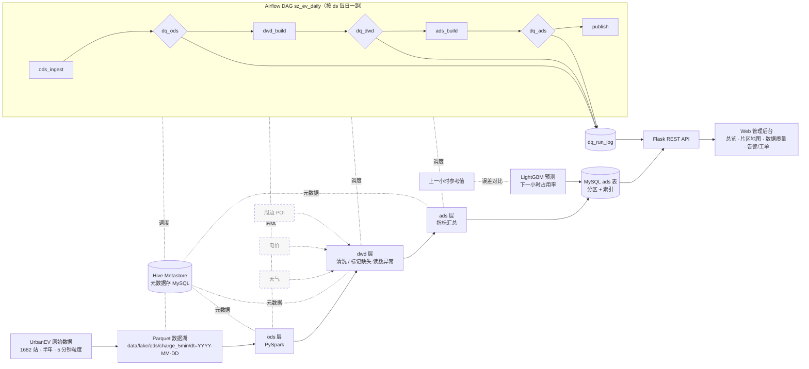

# 系统架构（总版）

> 深圳市电动汽车充电站运行管理系统 · 个人数据工程项目。本文件给出整体框架，各模块细节由负责人在下方占位处补充。

## 1. 架构图

虚线框（天气 / 电价 / POI 关联）为预留扩展，本轮不做。

## 2. 分层
- **ods**：原始数据按天落 Parquet，字段不改，只加 `load_at`、`src_file`。
- **dwd**：清洗、类型统一，标记整行缺失、读数长时间不变、离群值，计算占用率。
- **ads**：面向页面的汇总指标（总览 KPI、片区小时曲线、站点质量、和上小时比），写回 MySQL 供接口查。

## 3. 分区
- 湖内按天分区 `dt=YYYY-MM-DD`；调度参数 `ds` 与 `dt` 一一对应。
- 每次运行覆盖写当天分区（幂等），重跑不会产生重复数据。
- MySQL ads 表按日期范围分区并建索引，接口只扫需要的日期。

## 4. 调度（小白负责）
- **工具**：Apache Airflow 2.x，单容器、LocalExecutor，元数据库放在现有 MySQL 的独立库 `airflow`，内存上限约 1.5G。备选 DolphinScheduler，功能全但组件多（master/worker/api/zk），单机内存不划算。
- **DAG `sz_ev_daily`**：`ods_ingest(ds) → dq_ods(ds) → dwd_build(ds) → dq_dwd(ds) → ads_build(ds) → dq_ads(ds) → publish(ds)`，每天一个运行实例。
- **增量**：每次只处理一个 `ds`；任务函数只是薄包装，按路径调用各负责人的脚本，参数统一为 `--ds YYYY-MM-DD`。
- **补跑**：`orchestration/scripts/run_backfill.sh 2022-09-01 2022-09-14`（内部是 `airflow dags backfill -s -e`），不起 Airflow 时用 `orchestration/run_day.py --ds` 循环跑同一条链路。
- **失败处理**：每个任务重试 2 次、间隔 5 分钟；失败写日志并记入 `dq_run_log`，邮件告警留了钩子默认关闭。
- **内存约定**：Airflow、Spark 不同时长驻；Airflow 只在演示调度时启动，跑完即停。

## 5. 数据质量（小白负责）
- 规则写在 `quality/rules/{ods,dwd,ads}.yml`，引擎 `quality/engine.py` 读取规则，对一个分区（CSV / Parquet）或一条 MySQL 查询执行。
- 规则类型：`not_null_rate`（非空率下限）、`range`（取值范围）、`row_count_min` / `row_count_delta`（行数下限、与前一天相比的波动）、`stuck_value`（同一站连续 N 个时段读数不变）、`duplicate_key`（主键重复）、`freshness`（最新时间不早于 ds）。
- 级别：`block` 不通过就让任务失败、阻断下游；`warn` 只记录。缺数比例 26.42%、读数异常 4 站、缺数偏多 6 站属于真实数据特征，按 `warn` 处理；主键重复、行数为 0、占用率越界等按 `block`。
- 每条规则的结果都写入 MySQL 表 `dq_run_log`（ds、层、规则、级别、实测值、阈值、是否通过、运行时间），数据质量页与告警页可以直接读。

## 6. 预测
LightGBM 预测片区下一小时占用率，特征为时间、滞后、片区特征；按时间切分训练/测试，与「用上一小时」的简单方法比较 MAE，结果写入 MySQL 供「和上小时比」页面使用。

## 7. 服务
Flask 只读 MySQL 中的 ads 表与 `dq_run_log`，前端为原生 HTML/JS + ECharts 的管理后台。

## 8. 各模块负责人补充

### 8.1 全量数据接入（小紫）
- 脚本：`etl/full_pipeline.py`，参数 `--ds YYYY-MM-DD`（单日）或 `--start/--end`（含首尾），`--stations all|N|id,id`，`--workers`（默认 4），`--batch-days`（默认 7）。
- 输出（hive 风格，`dt` 只在目录名里）：`data/lake/ods/charge_5min/dt=YYYY-MM-DD/part-0.parquet`、`data/lake/dwd/charge_5min_clean/dt=YYYY-MM-DD/part-0.parquet`，站点质检 `data/lake/dwd/quality_station/run=<start>_<end>/`。snappy 压缩，`ts` 为 timestamp[us]，Spark 可直接 `spark.read.parquet` 或建 Hive 外表 `PARTITIONED BY (dt string)`。
- 幂等：每个分区先写 `.tmp_dt=…` 再整体替换，重跑同一天只覆盖该分区。
- 清洗规则沿用演示子集（整行缺失 / 卡死站 / 站内 IQR 异常 / occupancy）；卡死和异常按本次运行窗口内每个站计算。
- 单日实测：1682 站 × 288 = 484,416 行，约 14 s，ODS 1.7 MB、DWD 1.3 MB。全量数字见 `docs/full_load_metrics.md`，质检见 `docs/quality_report_full.md`。

### 8.2 Spark / Hive 离线数仓（小黑）
> 【待小黑补充】ods/dwd/ads 的 Spark SQL 作业路径与参数（约定 `--ds`）、Metastore 配置、driver 内存、写回 MySQL 的表与索引、查询优化前后耗时。

### 8.3 测试 / CI 与预测（小粉）
> 【待小粉补充】pytest 范围、GitHub Actions 流程、`forecast/` 训练与评估方式、MAE 结果。

### 8.4 接口与前端（小黑 / 小黄）
> 【待小黑补充】接口与 MySQL ads 表的部分。

**前端（小黄）**
- 单文件 `web/index.html`，浅色管理后台布局，按地址栏 `#/页面名` 切页，图表用 ECharts；共七页：运行总览、片区分析、和上小时比、片区地图、数据质量、异常告警、运维工单。
- 每页只通过一个取数函数拿数据（如 `fetchMapData()`、`fetchAlerts()`/`saveAlert()`），以后接口换成查 MySQL ads 表、加预测字段，只改这些函数；接口连不上时回落到页面内置的离线样例。
- 片区地图：`GET /api/map/zones` 返回每个片区的中心经纬度（片区内站点坐标取平均）、站数、桩数、平均占用率，以及每个站的坐标和状态。目前没有片区边界数据，先用经纬度散点图，颜色表示忙闲，圆的大小表示桩数；点片区下钻到站点表。
- 异常告警：`GET /api/alerts` 由站点检查结果生成（读数不动、缺数比例超过 30%、断档 2 天以上），`PATCH /api/alerts/<id>` 改状态（open / processing / closed），只有管理员能改。状态暂存在服务进程内存里，重启会恢复；MySQL 模式下计划落到 ads 告警表。
- 访客只能看，管理员（登录时选择）可以处理告警和工单。

### 8.5 调度与质检（小白）
已在第 4、5 节写完；设计细节见 `docs/orchestration_design.md`。
