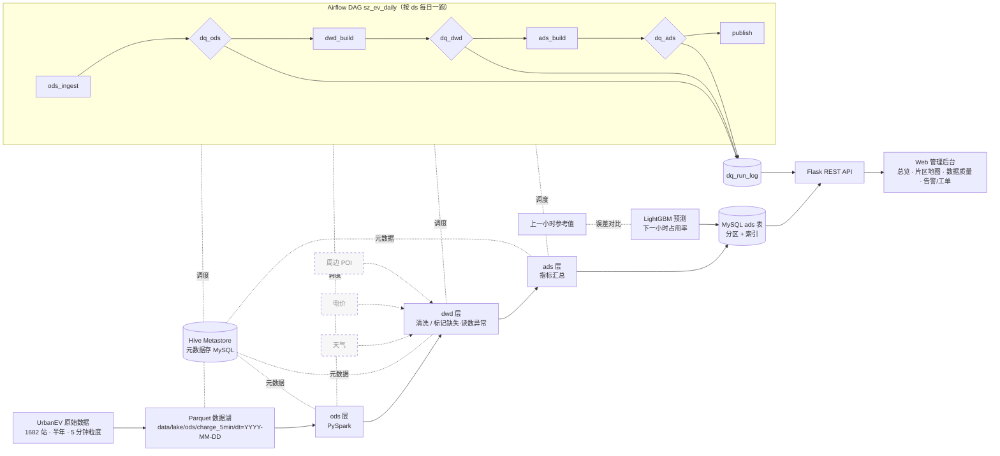

# 系统架构（总版）

> 深圳市电动汽车充电站运行管理系统 · 个人数据工程项目。本文件给出整体框架，各模块细节由负责人在下方占位处补充。

## 1. 架构图

虚线框（天气 / 电价 / POI 关联）为预留扩展，本轮不做。

## 2. 分层
- **ods**：原始数据按天落 Parquet，字段不改，只加 `load_at`、`src_file`。
- **dwd**：清洗、类型统一，标记整行缺失、读数长时间不变、离群值，计算占用率。
- **ads**：面向页面的汇总指标（总览 KPI、片区小时曲线、站点质量、和上小时比），写回 MySQL 供接口查。

## 3. 分区
- 湖内按天分区 `dt=YYYY-MM-DD`；调度参数 `ds` 与 `dt` 一一对应。
- 每次运行覆盖写当天分区（幂等），重跑不会产生重复数据。
- MySQL ads 表按日期范围分区并建索引，接口只扫需要的日期。

## 4. 调度（小白负责）
- **工具**：Apache Airflow 2.x，单容器、LocalExecutor，元数据库放在现有 MySQL 的独立库 `airflow`，内存上限约 1.5G。备选 DolphinScheduler，功能全但组件多（master/worker/api/zk），单机内存不划算。
- **DAG `sz_ev_daily`**：`ods_ingest(ds) → dq_ods(ds) → dwd_build(ds) → dq_dwd(ds) → ads_build(ds) → dq_ads(ds) → publish(ds)`，每天一个运行实例。
- **增量**：每次只处理一个 `ds`；任务函数只是薄包装，按路径调用各负责人的脚本，参数统一为 `--ds YYYY-MM-DD`。
- **补跑**：`orchestration/scripts/run_backfill.sh 2022-09-01 2022-09-14`（内部是 `airflow dags backfill -s -e`），不起 Airflow 时用 `orchestration/run_day.py --ds` 循环跑同一条链路。
- **失败处理**：每个任务重试 2 次、间隔 5 分钟；失败写日志并记入 `dq_run_log`，邮件告警留了钩子默认关闭。
- **内存约定**：Airflow、Spark 不同时长驻；Airflow 只在演示调度时启动，跑完即停。

## 5. 数据质量（小白负责）
- 规则写在 `quality/rules/{ods,dwd,ads}.yml`，引擎 `quality/engine.py` 读取规则，对一个分区（CSV / Parquet）或一条 MySQL 查询执行。
- 规则类型：`not_null_rate`（非空率下限）、`range`（取值范围）、`row_count_min` / `row_count_delta`（行数下限、与前一天相比的波动）、`stuck_value`（同一站连续 N 个时段读数不变）、`duplicate_key`（主键重复）、`freshness`（最新时间不早于 ds）。
- 级别：`block` 不通过就让任务失败、阻断下游；`warn` 只记录。缺数比例 26.42%、读数异常 4 站、缺数偏多 6 站属于真实数据特征，按 `warn` 处理；主键重复、行数为 0、占用率越界等按 `block`。
- 每条规则的结果都写入 MySQL 表 `dq_run_log`（ds、层、规则、级别、实测值、阈值、是否通过、运行时间），数据质量页与告警页可以直接读。

## 6. 预测
LightGBM 预测片区下一小时占用率，和「直接用上一小时」比较，最后 28 天测试 MAE 0.0255 对 0.0285。细节和接口字段见 8.3。

## 7. 服务
Flask 只读 MySQL 中的 ads 表与 `dq_run_log`，前端为原生 HTML/JS + ECharts 的管理后台。

## 8. 各模块负责人补充

### 8.1 全量数据接入（小紫）
- 脚本：`etl/full_pipeline.py`，参数 `--ds YYYY-MM-DD`（单日）或 `--start/--end`（含首尾），`--stations all|N|id,id`，`--workers`（默认 4），`--batch-days`（默认 7）。
- 输出（hive 风格，`dt` 只在目录名里）：`data/lake/ods/charge_5min/dt=YYYY-MM-DD/part-0.parquet`、`data/lake/dwd/charge_5min_clean/dt=YYYY-MM-DD/part-0.parquet`，站点质检 `data/lake/dwd/quality_station/run=<start>_<end>/`。snappy 压缩，`ts` 为 timestamp[us]，Spark 可直接 `spark.read.parquet` 或建 Hive 外表 `PARTITIONED BY (dt string)`。
- 幂等：每个分区先写 `.tmp_dt=…` 再整体替换，重跑同一天只覆盖该分区。
- 清洗规则沿用演示子集（整行缺失 / 卡死站 / 站内 IQR 异常 / occupancy）；卡死和异常按本次运行窗口内每个站计算。
- 实测：单日 484,416 行约 14 s；全量 181 天 87,679,296 行，6 分 38 秒，ODS 82.3 MB、DWD 67.6 MB（源 CSV 5.09 GB）。数字见 `docs/full_load_metrics.md`，质检见 `docs/quality_report_full.md`。
- 调度调用：`SZ_EV_LAKE=/workspace/sz-ev-charging/data/lake python etl/full_pipeline.py --start YYYY-MM-DD --end YYYY-MM-DD --layer ods|dwd|all`（单日可用 `--ds`）。站点维表：`data/lake/ods/station_info/part-0.parquet`。

### 8.2 Spark / Hive 离线数仓（小黑）
- 调度入口（与 `orchestration/tasks.py` 对齐）：
  - `spark/jobs/ads_build.py --ds D`（也支持 `--start/--end`）：把 `$SZ_EV_LAKE/dwd/charge_5min_clean` 注册为 Hive 外表 `dwd.ext_charge_5min_clean`（dt 分区，MSCK REPAIR），不再重做清洗；生成 `dwd.zone_hour`、`ads.*`，并写出 `$SZ_EV_LAKE/ads/zone_hour/dt=D/`（taz_id, ts_hour, occupancy_avg, busy_sum, piles_sum, station_cnt, center_lon, center_lat）和 `ads/zone_daily/dt=D/`。
  - `spark/jobs/export_ads_mysql.py --ds D [--dry-run]`：回写 MySQL `ads_city_overview / ads_zone_occupancy_hour / ads_baseline_naive / ads_zone_daily / dim_station / ads_quality_summary`。
- 独立链路：`spark/run_range.sh --start D1 --end D2 [--from-lake-dwd] [--dry-run]`，依次跑 ods_load → dwd_clean → ads_metrics。
- 幂等：Hive 表按 dt 分区，动态分区 INSERT OVERWRITE；湖输出按分区覆盖；MySQL 按日期 DELETE+INSERT，不分区表 REPLACE。
- Metastore：内嵌 Derby（`spark/conf/hive-site.xml`，配置里附 MySQL Metastore 示例），同一时刻只允许一个作业进程。
- 资源：`local[2]`，driver 2g（`SZ_DRIVER_MEM` 可改）。
- 新表 DDL 在 `sql/ads/04_ads_zone_daily_dim_station.sql`：ads_zone_daily 主键 (dt, taz_id)，dim_station 主键 station_id。
- 耗时基线见 `docs/perf/spark_baseline.md`，设计说明见 `docs/warehouse_design.md`。

### 8.3 测试 / CI 与预测（小粉）
**测试**
- 全部用 pytest，放在 `tests/`，本地 `pip install -r requirements-dev.txt` 后在仓库根目录跑 `pytest -q`。
- 覆盖：清洗和质检规则（用自己造的小数据跑 `etl/clean_to_dwd.py`）；接口（Flask 自带的测试客户端，文件模式下的总览、片区、站点、和上小时比、工单、告警、登录，数字和验收清单一致）；MySQL 模式（用假的查库函数替代真库，检查字段和文件模式一样，连不上时退回文件）；预测特征（只用过去的数据、不跨片区、按时间切分）；调度和质检引擎（`tests/orchestration/`，没装 Airflow 的那一项会跳过）。
- 防回归：工单和告警改状态只认登录 token，访客 403、没登录或 token 不对 401，开了 `ALERT_DB=mysql` 也一样，而且没权限时不会写库；导入 app 时地图、告警、工单路由都要在（防止以前的 405 再出现）。
- 设 `SZ_TEST_MYSQL=1` 时会额外连真实 `sz_ev` 做冒烟测试，平时跳过。

**CI**
- `.github/workflows/ci.yml`：推到 main 或开 PR 时自动跑全部 pytest 和一次预测冒烟训练；另一个任务用 `scripts/start.sh` 起整套 Docker 服务，探一下关键接口（这个任务失败不挡合并）。

**预测（`forecast/`）**
- 目标：预测每个片区下一小时的平均占用率，对照的是最简单的做法「直接用上一小时的值」（lag1）。
- 数据：读小紫的 `dwd/charge_5min_clean/dt=*/`，一天一天读进来马上按「片区 + 小时」求平均，不会把 8768 万行一次装进内存。入口只有一个函数 `load_zone_hour`，也能读演示用的 CSV；少于 7 天会直接报错。
- 用到的信息：几点、星期几、是不是周末；1、2、24、168 小时前的值；过去 168 小时的平均；上一小时比再前一小时变了多少；过去 4 周同一时刻的平均；片区编号。全都只看预测时刻之前的数据。
- 怎么评：按时间切开，2023-02-01 之前训练，最后 28 天（2 月 1–28 日）测试，331 个片区。
- 结果：

| 方法 | 平均误差 MAE | 大误差加重的 RMSE |
|---|---|---|
| 直接用上一小时 | 0.02849 | 0.05778 |
| LightGBM | 0.02548 | 0.04614 |

  MAE 低约 11%，RMSE 低约 20%。331 个片区里，MAE 更低的有 174 个，RMSE 更低的有 289 个。好处主要在忙闲突然变化的时候；本来就平稳的片区，上一小时的值已经很准，两者差不多。
- 输出：`forecast/metrics.json`（整体和每个片区的误差）、`forecast/predictions.csv`（为了文件小，只留 2 月 27–28 日两天的逐小时预测）。
- 复现：`python -m forecast.train --source data/lake/dwd/charge_5min_clean --test-days 28`，约 4 分钟。

**预测接口（`GET /api/baseline`）**
- 每个点在原来的 `y_true`、`y_hat_lag1`、`abs_err` 之外多两个字段：`y_hat_lgbm`（LightGBM 预测值）、`abs_err_lgbm`（和真实值差多少）。不在预测那两天里的点，这两个字段是 null。
- 顶层多 `metrics`（`mae_lgbm`、`mae_lag1`、`rmse_lgbm`、`rmse_lag1`、`split_ts`，`split_ts` 是 2023-02-01，表示误差按 28 天算）和 `forecast_window`（有预测的起止时间，即 2 月 27–28 日），前端据此跳到有预测的日期。
- 文件模式（默认）读 `forecast/predictions.csv` 和 `metrics.json`；`API_SOURCE=mysql` 时其余数字读 `sz_ev` 的 ads 表，预测字段照样补上，字段名两种模式一样。预测文件不在时这些字段为空，页面不画预测线，不报错。

### 8.4 接口与前端（小黑 / 小黄）
> 【待小黑补充】接口与 MySQL ads 表的部分。

**前端（小黄）**
- 单文件 `web/index.html`，浅色管理后台布局，按地址栏 `#/页面名` 切页，图表用 ECharts；共七页：运行总览、片区分析、和上小时比、片区地图、数据质量、异常告警、运维工单。
- 每页只通过一个取数函数拿数据（如 `fetchMapData()`、`fetchAlerts()`/`saveAlert()`），以后接口换成查 MySQL ads 表、加预测字段，只改这些函数；接口连不上时回落到页面内置的离线样例。
- 片区地图：`GET /api/map/zones` 返回每个片区的中心经纬度（片区内站点坐标取平均）、站数、桩数、平均占用率，以及每个站的坐标和状态。目前没有片区边界数据，先用经纬度散点图，颜色表示忙闲，圆的大小表示桩数；点片区下钻到站点表。
- 异常告警：`GET /api/alerts` 由站点检查结果生成（读数不动、缺数比例超过 30%、断档 2 天以上），`PATCH /api/alerts/<id>` 改状态（open / ack / closed，页面显示为待处理 / 处理中 / 已关闭），只有管理员能改（按登录拿到的 token 判断，前端放在 `Authorization: Bearer` 请求头里）。设置 `ALERT_DB=mysql` 后读写 MySQL 表 `dq_alert`（小白建表），连不上或未设置时用进程内存兜底。
- 和上小时比：`/api/baseline` 的点里带 `y_hat_lgbm` / `abs_err_lgbm`、顶层带 `mae_lgbm` 等指标时，额外画预测线和四张误差卡片；没有这些字段就不显示。
- 访客只能看，管理员（登录时选择）可以处理告警和工单。

### 8.5 调度与质检（小白）
已在第 4、5 节写完；设计细节见 `docs/orchestration_design.md`。

**全量数据（小黄补充）**：设置 `SZ_EV_LAKE=<lake 根目录>` 后，`/api/map/zones` 直接读 `ods/station_info`（站点坐标、所属片区）和 `ads/zone_hour`（按片区把逐小时占用率求平均），有 `dwd/quality_station` 时顺带给出每站缺数比例；站点超过 300 个时不一次返回，前端点片区时再用 `?taz_id=` 取。没设或文件不全时退回演示数据。告警表按 `quality/sql/dq_alert.sql` 读写（`alert_id`、`ds`、`layer`、`rule_name`、`severity`、`metric_value`、`threshold`、`note`），改状态时同时更新 `updated_at`；整批规则产生的告警没有站和片区，页面显示「整批数据」。

**地图数据来源顺序（小黄补充）**：`MAP_DB=mysql` 时先读库（`dim_station` + `ads_zone_daily` 最新一天）；连不上或没设时读 `SZ_EV_LAKE`（默认 `data/lake`）下的 `ods/station_info` + `ads/zone_hour`，片区中心优先用 `center_lon/center_lat`，没有占用率的小时用 `busy_sum/piles_sum` 补；都没有才用演示 CSV。未知 `/api/*` 路径回 404（以前回 405，容易误以为方法错）。
