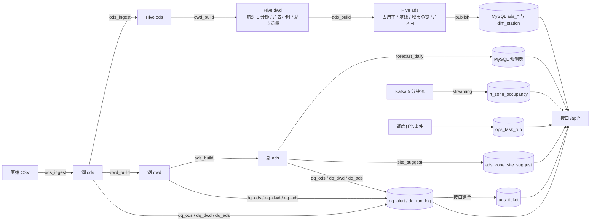
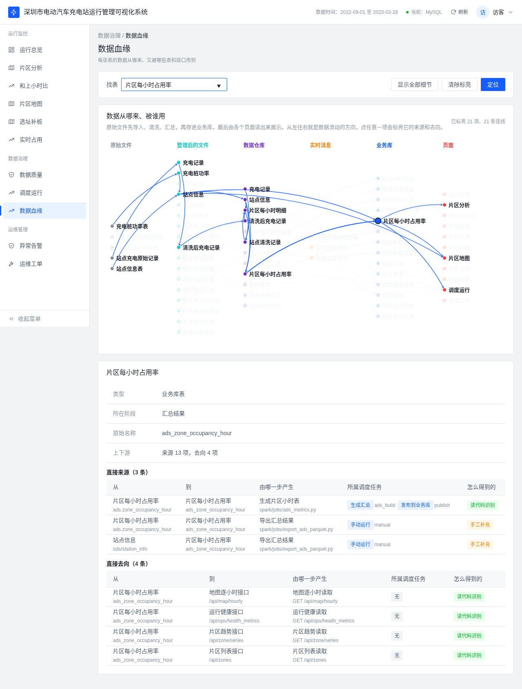

# 数据关系（表级）

这份文档说明每张表的数据从哪来、被谁用。数据关系是**读代码得出的**，不连库、不跑 Spark/Airflow。

- 生成脚本：`lineage/build_lineage.py`（扫 `etl/`、`spark/jobs/`、`forecast/`、`stream/`、`quality/`、`orchestration/` 里的 SQL 和 `api/` 的路由）
- 手工补充：`lineage/overrides.yml`（脚本到 Airflow 任务的对应、经临时视图中转认不出来的边、文件读写等）
- 结果：`lineage/lineage.json`，当前 **72 个节点、111 条边**（52 条自动推断，59 条手工补充）
- 接口：`GET /api/lineage`

改了 SQL 或表之后跑一次 `python lineage/build_lineage.py`；`--check` 只检查不写文件，测试 `tests/test_lineage.py` 会用它，文件没更新测试就会失败。测试还会检查：接口读的每张 MySQL 表都必须有上游。

## 节点类型

| 类型 | 个数 | 例子 |
|---|---|---|
| raw 原始文件 | 5 | UrbanEV 充电数据、站点信息、天气 CSV |
| lake 数据湖目录（Parquet） | 17 | `ods/charge_5min`、`dwd/quality_station`、`ads/zone_hour` |
| hive Hive 表 | 12 | `ods.charge_5min`、`dwd.zone_hour`、`ads.zone_daily` |
| mysql MySQL 表 | 14 | `ads_zone_occupancy_hour`、`dq_alert`、`ads_ticket`、`rt_zone_occupancy` |
| stream 消息流 | 2 | Kafka `charge_5min`、调度任务事件 |
| file 文件 | 1 | `lineage/lineage.json` |
| api 接口 | 21 | `/api/overview`、`/api/alerts`、`/api/realtime/zones` |

## 总览图

只画主线，细节以 `lineage.json` 为准。

## 接口读哪些表

| 接口 | 读的 MySQL 表 |
|---|---|
| `/api/overview`、`/api/data_range` | ads_city_overview |
| `/api/zones`、`/api/zone/series`、`/api/map/hourly` | ads_zone_occupancy_hour |
| `/api/map/zones` | ads_zone_daily、dim_station（湖模式下读 `ods/station_info`、`ads/zone_hour`） |
| `/api/baseline` | ads_baseline_naive、ads_forecast_zone_hour |
| `/api/forecast/metrics` | ads_forecast_metric_daily |
| `/api/quality` | ads_quality_summary |
| `/api/alerts` | dq_alert（PATCH 也会写回） |
| `/api/tickets` | ads_ticket、dq_alert（POST/PATCH 会写 ads_ticket） |
| `/api/site/suggest` | ads_zone_site_suggest |
| `/api/realtime/zones` | rt_zone_occupancy |
| `/api/runs`、`/api/ops/runs` | ops_task_run |
| `/api/ops/health_metrics` | dq_alert、dq_run_log、ops_task_run、ads_zone_occupancy_hour、ads_forecast_zone_hour |

## 前端页面

页面 `#/lineage`（菜单「数据治理」）把数据关系画成六列：原始文件、数据湖、Hive、消息流与文件、业务库、接口。

- 点一个节点，会标亮它的上游和下游，并显示产出它的脚本和调度任务。
- 可以按表名搜索。

## 已知局限

- 只到表级，不到字段级。
- Spark 里通过临时视图（`v_ext`、`v_base`、`{src}`）中转的读，脚本认不出来，这些边写在 `overrides.yml` 里，改 Spark 作业时要顺手改。
- `etl/load_mysql_from_demo.py`（空库第一次启动时装演示数据）没有纳入，不然会多出一堆演示用的边。
- 建了表但目前没人读写的：`ods_calendar_day`、`ods_weather_zone_h` 等，列在 `lineage.json` 的 `unused_mysql_tables` 里。
